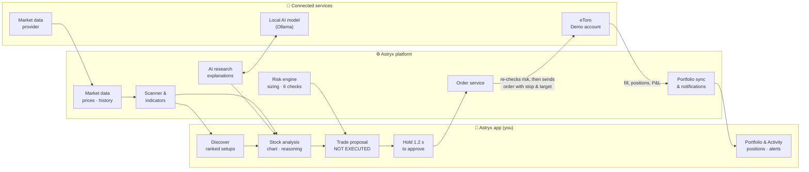

# Astryx: how it works, end to end

A one-page overview for clients and stakeholders. Technical detail lives in [`SYSTEM_DESIGN.md`](../SYSTEM_DESIGN.md).

Astryx is a private mobile trading workstation. It finds stock setups, explains them, sizes a trade within your risk limits, and places it in your **eToro Demo** account only after you hold to approve. Real-money trading is switched off.

## The journey in seven steps

| # | What you see | What happens behind the scenes | Connected service |
|---|---|---|---|
| 1 | Prices marked "Updated 14:32 ET" | Prices and history are collected and checked for freshness. Stale data blocks approvals | Market data provider (or eToro data) |
| 2 | **Discover:** ranked setups such as NVDA, Breakout, score 87 | The scanner applies strategy rules to about 1,000 US stocks and ranks them with a deterministic score | — |
| 3 | **Stock analysis:** chart, evidence, invalidation, AI explanation | Indicators (RSI, MACD, ATR, moving averages) are computed exactly. AI writes the explanation but never sets prices or sizes | Local AI model |
| 4 | **Trade proposal** in amber, "Not executed" | The risk engine sizes the trade (risk per trade, 12% position cap, cash) and runs six pre-trade checks. Any failure disables approval | — |
| 5 | **Hold to approve** for 1.2 s | The server re-checks risk against a fresh price. The request is idempotent, so a retry can never place two orders | — |
| 6 | **Fill receipt** in green with the order ID | The order goes to your eToro Demo account with stop-loss and take-profit attached, and the fill is confirmed | eToro (Demo) |
| 7 | **Portfolio and Activity**, NEW badge, alerts | Positions and P&L sync from eToro. Alerts fire near stops. Exits at stop or target are recorded | eToro (Demo), push notifications |

## Safety rails

- **Research is never mistaken for a trade.** Amber, dashed and "Not executed" until you approve. Green with an order ID only after a fill.
- **One way to place an order:** proposal → risk checks → confirm sheet → hold 1.2 s.
- **No overrides.** A failed check cannot be bypassed in the app or the API.
- **AI advises; it never decides** prices, sizes, limits or orders.
- **Demo money only.** eToro Real is behind legal, operational and safety gates (`SYSTEM_DESIGN.md` §17.9). The app never touches deposits or withdrawals.
