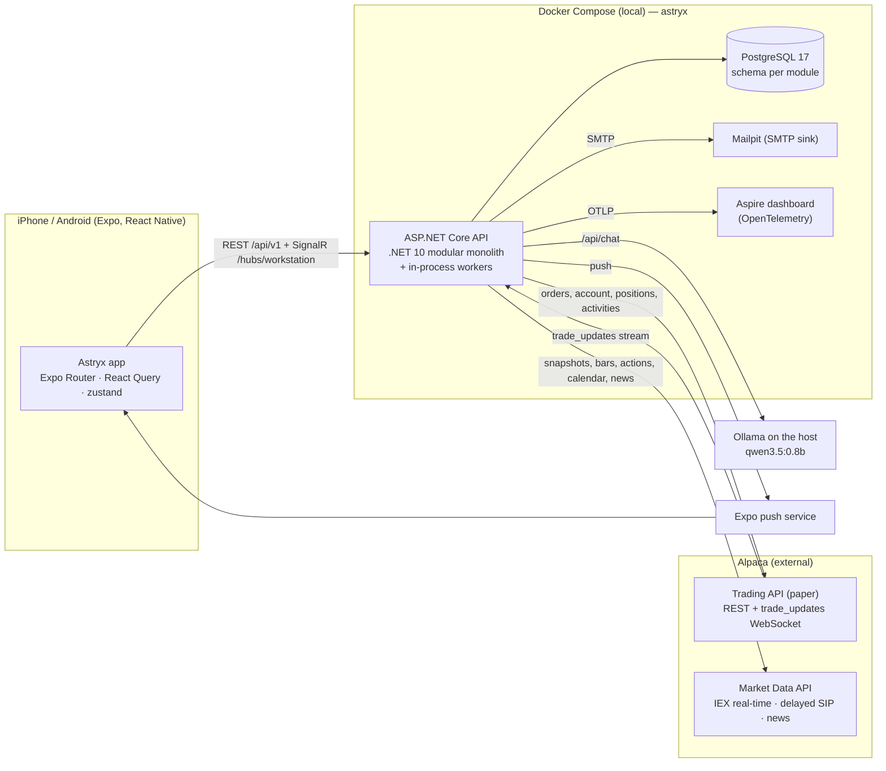
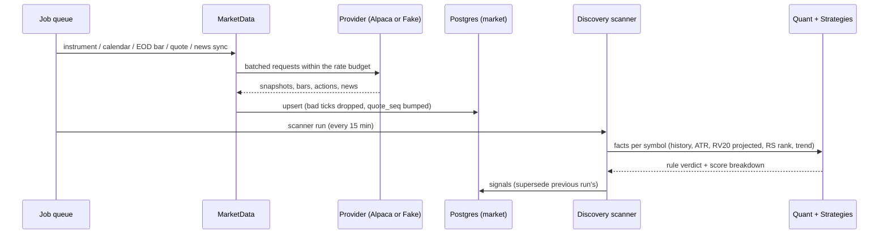
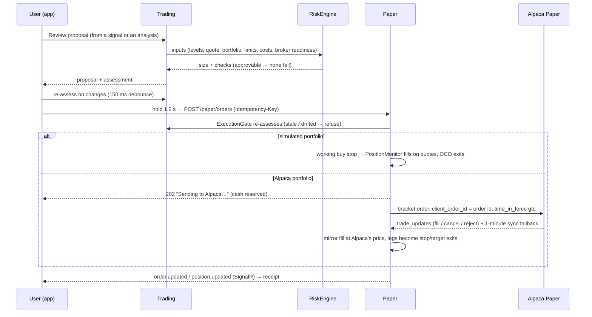

# Astryx: the system end to end

This document describes Astryx as it is **built and running**: architecture, modules, providers (real and fake), data flows, background work, the API, the mobile app, safety, operations and every layer of testing. Code state as of 2026-11-23 (`39f975b`).

- **`SYSTEM_DESIGN.md`:** the specification and the source of truth for decisions (§ references below point into it).
- **`TASKS.md`:** what is done and what is open.
- **`docs/PRODUCT_FLOW.md`:** the user journey.

When this document and the code disagree, the code wins. Please fix this document when that happens.

---

## 1. What Astryx is

Astryx is a **mobile AI trading workstation for US stocks**. It does four things:
1. Scans the S&P 500 for strategy setups.
2. Researches a stock with deterministic indicators and an optional local AI summary.
3. Turns a setup into a **trade proposal** that a deterministic **risk engine** sizes and checks.
4. Executes it only after the user **holds to approve**, in a **paper** account: either Astryx's own simulator or the user's **Alpaca Paper** account.

**Ground rules enforced in code:**
- **No real money.** Alpaca Live is designed but disabled, and the `Features:LiveTrading` flag fails startup until the real-money gates (T-130 to T-136) pass.
- **The AI is advisory.** It never creates or sizes an order. The risk engine is authoritative and has no override.
- **Cash only.** Sizing uses cash, never margin or buying power.
- **Long only.** US equities, whole shares, regular session only.
- **No floating point in money paths.** Prices, quantities and percentages are `decimal` in .NET and decimal strings on the wire. An architecture test bans `double` in the modules.
- **Data is scoped per user.** Another user's resource returns 404 (`DataIsolationTests`).
- **Broker secrets** are envelope-encrypted, never logged, never sent to the phone and never committed.

---

## 2. Architecture at a glance



- **One deployable:** `apps/api` hosts the HTTP API, the SignalR hub and the background workers in one process. `Workers:Enabled` and `Workers:Jobs` can split them later.
- **Modular monolith:** each module owns its database schema, its `DbContext` and its migrations. Modules talk only through interfaces and events in `Astryx.Contracts`; `ModuleBoundaryTests` enforces this.
- **Transactions:** `ModuleUnitOfWork` shares one transaction across modules for a single use case, such as a fill that touches orders, the ledger and positions.
- **Events:** integration events go through a transactional **outbox** and are dispatched in-process, at least once, to idempotent handlers.

---

## 3. Repository layout

| Path | What lives there |
|---|---|
| `apps/api` | Host: `Program.cs`, the OpenAPI document (`openapi.json`, committed), dev-only endpoints (`Dev/`), test-only endpoints (`TestSupport/`), typed `/system/status` |
| `apps/mobile` | Expo app: routes in `src/app`, features in `src/features`, Maestro flows in `e2e/` |
| `packages/api-client` | Typed TypeScript client. Zod schemas `satisfies` the types generated from `openapi.json` |
| `packages/design-tokens` | Colours, type scale, spacing and radii from the design ("Graphite") |
| `src/BuildingBlocks/Astryx.SharedKernel` | `Money`, price, quantity and percent types, `Result`, `Ids` (UUID v7), rounding policy, financial JSON |
| `src/BuildingBlocks/Astryx.Contracts` | Cross-module interfaces, DTO records and integration events |
| `src/BuildingBlocks/Astryx.Infrastructure` | Persistence, outbox, job queue, idempotency, HTTP and rate limits, auth, credential vault, Alpaca HTTP core, realtime hub, observability |
| `src/Modules/*` | The 13 modules (§4) |
| `src/Workers/Astryx.Workers` | Registers the outbox dispatcher, job runner and maintenance services |
| `tests/*` | Unit, architecture and integration tests, fixtures, k6 load script |
| `infra/docker` | `docker-compose.yml` (everyday stack), `docker-compose.load.yml` (isolated load stack), the API Dockerfile |
| `infra/observability` | `alerts.yml` (14 Prometheus rules) |
| `docs/` | ADRs 022–024 (001–021 are in `SYSTEM_DESIGN.md`), runbooks, load reports, AI eval, security notes, strategy rule drafts, this file |
| `.github/workflows` | `ci.yml` (every push and PR), `alpaca-paper-smoke.yml` (manual) |

---

## 4. Backend modules

| Module | Schema | Owns | Key pieces |
|---|---|---|---|
| **Identity** | `identity` | Accounts, email verification, password reset, sessions | PBKDF2 (600k iterations), JWT access tokens (15 min) with key rotation, refresh-token families bound to a device (30 days, reuse detection), auth rate limits |
| **Profiles** | `identity` | `/me`, preferences, risk settings | Risk limits per user (risk per trade, weight cap, sector cap, daily loss halt, max positions, min R:R) |
| **MarketData** | `market` | Instruments, daily and intraday bars, quotes, corporate actions, calendar, news, fundamentals, provider sync state | Provider abstraction (§5), ingestion jobs, `MarketClock` (calendar cached 10 min), `FreshnessPolicy`, split and dividend adjustment, batched sparklines (`GetTrailsAsync`) |
| **Quant** | — (uses `market`) | Indicators and facts for rules | SMA, EMA, Wilder RSI and ATR, MACD 12/26/9, relative volume, ROC, relative-strength percentile rank, trend classifier; forming-volume projection for real data; golden-file tested |
| **Strategies** | `strategy` | Strategy catalog, versions, parameters, backtest runs (seeded), drawdown guard | `BaseBreakoutRule` (the only rule implemented); `catalog.json` seed; drawdown guard pauses a strategy at −6% over 30 days |
| **Discovery** | `discovery` | Scanner runs, signals, search | 15-minute scanner over the universe, signals with score breakdown, filters, cursor pages |
| **Watchlists** | `watchlist` | Watchlists and items | Default watchlist per user; feeds quote priority |
| **Ai** | `ai` | Analysis jobs and results, prompt versions | `IAiProvider` → Ollama `/api/chat`; versioned prompts; output validator; circuit breaker; local eval set (`docs/ai-eval`) |
| **Trading** | `trading` | Proposals, risk assessments | `RiskEngine` (pure, deterministic), `AssessmentService`, `ExecutionGate`, proposal expiry, `ProposalReopener` (broker rejection → pending) |
| **Paper** | `trading` | Orders, fills, broker connections | Simulator (`PaperExecution`, `PositionMonitor`), Alpaca execution (`AlpacaExecution`, `TradeUpdatesListener`, `BrokerReadinessService`), connection service with the credential vault |
| **Portfolio** | `portfolio` | Portfolios, append-only cash ledger, positions, snapshots | Ledger with idempotency references, valuation, performance, reconciliation (nightly and broker), epochs (reset, reconnect) |
| **Notifications** | `notify` | Activity feed, devices, push | Expo push gateway behind `Features:Push`; push records in dev and tests |
| **Audit** | `audit` | Audit log (partitioned) | Redaction of secrets and PII; partition maintenance |

**Cross-cutting infrastructure:**
- **Outbox:** each module publishes events in its own transaction; the dispatcher delivers them with backoff.
- **Job queue:** Postgres `infra.job_queue`, claimed with `FOR UPDATE SKIP LOCKED`, with retries, backoff and dead-lettering.
- **Idempotency:** the `Idempotency-Key` header on money-moving POSTs; replays return the stored response.
- **Rate limits:** per IP for auth; per user for general use, assessments, orders, analyses and sync.
- **Row-level security:** ADR 022.

---

## 5. Providers: real and fake

Each external dependency sits behind an interface with at least one fake, so tests, CI, E2E and the load test never need the internet.

| Concern | Interface | Real implementation | Fake / local implementation | Switch |
|---|---|---|---|---|
| Market data | `IMarketDataProvider` | `AlpacaMarketDataProvider` | `FakeMarketDataProvider` | `MarketData:Provider` = `Fake` (default) \| `Alpaca` |
| News | `INewsProvider` | `AlpacaNewsProvider` | `FakeNewsProvider` (`tests/fixtures/market/news.json`) | `News:Provider` (follows the market data provider when Alpaca) |
| Brokerage | `IAlpacaTradingClient` (+ simulator path) | `AlpacaTradingClient` (paper host) | Built-in simulator (`Broker:Adapter=Mock`, broker code `mock`) for users without a connection; `FakeAlpaca` in tests | Per user: connecting Alpaca in Settings switches that user's trading to the Alpaca portfolio |
| Broker stream | `IAlpacaTradeUpdates` | `AlpacaTradeUpdatesStream` (`wss://paper-api.alpaca.markets/stream`) | Tests call `TradeUpdatesListener.HandleAsync` directly | `Alpaca:Streaming` (default on with the job workers) |
| AI | `IAiProvider` | `OllamaAiProvider` (local model) | Stubs in tests; `analysis.yaml` E2E covers the unavailable path | `Ai:Provider`, `Ai:Ollama:*` |
| Email | SMTP sender | Any SMTP server | Mailpit in compose (http://localhost:8025); captured in tests | `Email:Smtp:*` |
| Push | `IPushGateway` | `ExpoPushGateway` (exp.host) | Recording gateway | `Features:Push`, `Push:Provider` |
| Secrets at rest | `CredentialVault` | AES-256-GCM envelope with a master key ring | Test keys | `Credentials:MasterKeys` (`id:base64`, rotating) |
| Error tracking | Sentry (API and app) | Sentry when a DSN is set | Off | `Sentry:Dsn`, `SENTRY_DSN` |
| Telemetry | OpenTelemetry | Any OTLP backend | Aspire dashboard (http://localhost:18888) | `OTEL_EXPORTER_OTLP_ENDPOINT` |

### 5.1 Real market data: Alpaca (ADR 024)

Alpaca's Basic plan is free with the brokerage account.

| Data | Source | Notes |
|---|---|---|
| Universe | Embedded `us_large_cap.csv` | S&P 500 constituents with GICS sectors (Alpaca has no sector data) |
| Last, bid, ask | Real-time **IEX** snapshots | Outside regular hours the quote is the consolidated **regular-session close** stamped at the bell, not an extended-hours print. Bid and ask only when the IEX spread is ≤ 2% |
| Day OHLCV, previous close | **15-minute-delayed consolidated (SIP)** snapshots | IEX alone carries a small share of volume |
| Daily and intraday history | Consolidated bars up to 16 minutes ago | Stored unadjusted; Astryx adjusts for splits and dividends |
| Corporate actions, calendar, news | Alpaca endpoints | Calendar rows cached in memory |
| Fundamentals | None | Alpaca has none; the screens show what is available |

- **Rate budget:** 200 requests/min per key. Ingestion uses 80 (`MARKET_DATA_REQUESTS_PER_MINUTE`) and the trading client has its own token bucket (180).
- **Licence (Q-04, open):** the Basic plan is for personal use. Showing this data to anyone but the account holder needs an owner decision (ADR 024).

### 5.2 Fake market data (default for tests, CI, E2E and load)

- **Universe:** `tests/fixtures/market/universe.csv` has 1,034 instruments. Each row carries a **pattern** that shapes its history:

  | Pattern | Count |
  |---|---|
  | `random` | 692 |
  | `trend` | 134 |
  | `flat` | 100 |
  | `downtrend` | 92 |
  | `momentum` | 10 |
  | `breakout` | 2 |
  | `pullback` | 2 |
  | `unusual_volume` | 1 |
  | `earnings` | 1 |

- **NVDA design fixture:** NVDA is the design's breakout (entry 186.50, stop 178.20, target 204.00, score 87). Its base low (176.85) and ATR(14) (5.5333) are pinned so the rule reproduces the design exactly.
- **History generation:** history is generated **backwards from today** (`FakeSeries`), seeded by `MarketData:Fake:Seed` and the symbol only, so the shape is identical every day. Before 944153a the date was part of the seed, and on some days NVDA's RS rank fell below the rule's threshold.
- **Other fixture files:** `calendar.csv` (half days and holidays), `corporate_actions.csv` and `news.json`.
- **Fault injection (`/dev/faults`, Development only):**
  - Freeze or kill the feed.
  - Force the session open.
  - Override prices.
  - Fail the scanner.

  The E2E flows and the load test use these.
- **Reseeding:** `POST /dev/market/reseed` re-generates fake bars for today and rescans.
- **Switching a database to real data:** `POST /dev/market/purge-fake` removes fake rows before Alpaca takes over.

### 5.3 Which data is where right now

| Environment | Market data | Broker | AI |
|---|---|---|---|
| Your local stack (`pnpm stack:up`, port 5080) | **Real** (Alpaca), via `.env` `MARKET_DATA_PROVIDER=Alpaca` | **Real Alpaca Paper** for `e2e-journey@example.com` (account PA3E445ZN); simulator for other users | Real local Ollama, when it's running |
| Load stack (`docker-compose.load.yml`, port 5081) | Fake | Simulator | — |
| Integration tests | Fake (Testcontainers Postgres per test class) | Simulator and `FakeAlpaca` | Stubs |
| CI | Fake | Fake | Stubs |
| Maestro E2E (`journey.yaml` and others) | Fake + dev faults | Simulator | Real or unavailable |
| `alpaca-journey.yaml` | Real | Real Alpaca Paper | — |
| Alpaca smoke tests | — | Real Alpaca Paper (a dedicated account) | — |

---

## 6. End-to-end flows

### 6.1 Data ingestion and the scanner



- **Quotes:** every 60 s during the session, plus once after the close. Priority symbols go first (positions, working orders, watchlists, signals), then the rest of the universe round-robin.
- **Freshness:**
  - During the session, a quote is fresh within its age budget.
  - After the close, a quote stamped within the budget of the bell counts as the close.
  - Stale data blocks approvals (`data_fresh`) and shows the connection banner.
- **Base Breakout (`base_breakout@1`, §13.4.1):**
  - **Base:** the last `baseWeeks × 5` sessions, with depth ≤ 20%.
  - **Trigger:** today's high breaks the base high, RV20 ≥ 1.8 (forming volume projected to a full day), RS rank ≥ 80, and the trend is not down.
  - **Entry:** buy stop at `ceil_0.10(high × 1.003)`.
  - **Stop:** `entry − 1.5 × ATR`.
  - **Target:** `high + 2 × base height`.
  - **Score:** setup, RS, volume, trend and R:R.
- **Other strategies:** Trend Momentum, Trend Pullback, RSI(2) Mean Reversion and Earnings Drift have **no rules yet**. Drafts await the owner (`docs/strategies/rules-draft.md`, Q-09).

### 6.2 Research

- **Stock page:** quote, chart (bars with MA20, MA50 and volume), RSI and MACD, the active signal ribbon and news.
- **AI analysis:**
  1. `POST /analyses` creates a job.
  2. The worker builds a context from stored data only (no live provider calls).
  3. It calls Ollama with a versioned prompt (`Ai:Prompts:stock_analysis`).
  4. It validates the JSON output.
  5. It stores the result and pushes `analysis.updated`.
- **Failure handling:** failures retry up to three times, then fail with `ai_provider_unavailable`, and the circuit breaker opens. Results always carry the "not investment advice" disclaimer.

### 6.3 Proposal → risk → approval → order



**Sizing:** the quantity is the smallest of three bounds: the risk bound (risk % of equity ÷ (stop distance + costs)), the weight-cap bound and the cash bound. The user may lower it.

**Checks** (§14.5):
- **Design checks, always shown:**
  - `risk_per_trade`, `position_weight`, `sector_exposure`
  - `cash_available`, `daily_loss_halt`, `session_open`
- **Engine checks, shown only when they warn or fail:**
  - `max_open_positions`, `levels_valid`, `reward_risk`, `no_duplicate`
  - `data_fresh`, `quantity_valid`
  - **Alpaca portfolios only:** `broker_connected`, `broker_write_permission`, `broker_eligible`

**Costs:**
- **Simulator:** 1 bp slippage (minimum $0.01) and the configured commission.
- **Alpaca:** commission-free, and half the quoted spread per share. Regulatory fees apply to live sells only and are not part of paper estimates (Q-23 deferred).

**Order rules:**
- **Proposals:** created during the regular session until 30 minutes before the close; one pending proposal per instrument.
- **Approvals:** stop 5 minutes before the close.

**Alpaca specifics** (§17.4, T-143 to T-148):
- **Brackets are sent `gtc`** so the stop and target legs survive the close. Alpaca gives legs the entry's time in force; this was verified in Paper on 2026-11-19.
- **Day lifetime of entries:** Astryx itself cancels and expires an unfilled entry after the close.
- **Idempotency:** lookup by `client_order_id` before any resubmit. A duplicate gets 422, and Astryx continues with the existing order. Overlapping submits in one process make a single call.
- **Rejection:** releases the cash reservation and returns the proposal to pending.
- **Stuck orders:** an entry unresolved 10 minutes after sending raises `BrokerOrderStuck`.

### 6.4 Positions, exits and the portfolio

- **Simulator:** `PositionMonitor` evaluates OCO stop and target legs on every quote batch. A gap through the stop fills at the open price.
- **Alpaca:** Alpaca fills the legs. The stream or the sync mirrors the exit fill with the correct exit reason.
- **Manual close:** cancels the bracket legs, then `DELETE /v2/positions/{symbol}`.
- **Ledger:** append-only cash entries:
  - `initial_deposit`, `buy`, `sell`, `fee`
  - `adjustment` (Alpaca cash reconciliation)
  - `reset_deposit` (paper reset, or reconnecting a different Alpaca account)
- **Valuation:** equity, day P&L, all-time P&L, allocation, performance against SPY and snapshots every 15 minutes.
- **Reconciliation:**
  - **Nightly:** the ledger against cached cash, positions against fills, orders and snapshots.
  - **Broker, every sync with nothing in flight:** Alpaca cash (adjustment), Alpaca positions and Alpaca FILL activities (last 24 h).
  - Any mismatch **halts new entries**; exits keep working. An operator clears the halt.

### 6.5 Broker sync cadence

| Trigger | What runs |
|---|---|
| `trade_updates` event | Settle the order the event is about (seconds) |
| Every minute in the session (recurring `paper.broker_sync`) | Expire past-close day entries, settle in-flight orders and legs, report stuck entries, reconcile accounts |
| Outside the session | Account reconciliation every 15 minutes per connection |
| Pull to refresh (`POST /portfolio/sync`) | The same for that user only, then revalue |

### 6.6 Accounts, onboarding and devices

1. Sign up, then verify by email (link → app).
2. Sign in, then accept the **onboarding disclaimer** once per account and device ("Paper trading only · Not investment advice · AI research is experimental").
3. The app opens on Home.

- **Connect Alpaca:** paste the paper key and secret. The server validates them against Alpaca, seals the secret and attaches the Alpaca portfolio.
- **Disconnect:** deletes the sealed secret and moves the user back to the simulator.
- **Tokens:** the access token is kept in memory; the refresh token and device id are in the iOS Keychain or Android Keystore.
- **Phone security:** screen protection on sensitive screens. Push tokens are registered only when the user allows notifications.

---

## 7. Background work

All jobs run on the Postgres job queue. Recurring schedules enqueue them; handlers are idempotent.

| Job | Every | Purpose |
|---|---|---|
| `market.quote_sync` | 1 min | Quotes (session, plus once after the close) |
| `market.eod_bar_sync` | 5 min | Daily bars once final |
| `market.instrument_sync` | 15 min | Universe |
| `market.fundamentals_sync` | 15 min | Fundamentals (fake only) |
| `market.news_sync` | 15 min | News |
| `market.calendar_sync` | 1 h | Trading calendar |
| `discovery.scanner_run` | 15 min (configurable) | Scan and signals |
| `trading.proposal_expiry` | 1 min | Expire proposals |
| `paper.broker_sync` | 1 min | Alpaca settlement, expiry, reconciliation (§6.5) |
| `paper.day_order_expiry` | 1 min | Simulator day entries |
| `paper.broker_submit` / `paper.broker_settle` | On demand | Send an Alpaca order; poll it with backoff |
| `portfolio.snapshot` | 15 min | Equity snapshots |
| `portfolio.start_of_day` | 5 min | Start-of-day equity for the daily loss halt |
| `portfolio.reconciliation` | 30 min | Reconciliation (each portfolio once per ~20 h) |
| `strategies.drawdown_guard` | 1 h | Pause strategies past the guard |
| `notifications.push` | On demand | Send a push |
| `identity.token_cleanup` | 1 day | Expired tokens |
| `infra.idempotency_cleanup` | 1 h | Old idempotency records |
| `audit.partition_maintenance` | 1 day | Audit partitions |

**Hosted services alongside the queue:**
- The outbox dispatcher.
- The job runner and its maintenance (reaper).
- `TradeUpdatesListener`: one reconnecting stream per connected account, with backoff from 1 s up to 60 s.

---

## 8. API surface

- **Basics:**
  - REST under `/api/v1`, JSON with decimals as strings.
  - Errors are RFC 7807 problems with a stable `code`.
  - Cursor pagination.
  - The OpenAPI document is generated in Development (`/openapi/v1.json`) and committed as `apps/api/openapi.json`.

| Group | Highlights |
|---|---|
| `/auth` | register, verify-email, resend-verification, login, refresh, logout, logout-all, forgot and reset password |
| `/me` | profile, preferences, risk settings, change password |
| `/market`, `/instruments` | session, breadth, quote, bars, fundamentals, news |
| `/search` | instrument search, recent searches |
| `/watchlists` | CRUD and items |
| `/signals`, `/scanner/status`, `/strategies` | signal list with filters and chip counts, `/signals/count`, signal detail and breakdown, scanner status, strategy catalog, backtests and the month-to-date summary (`/strategies/summary?period=mtd`) |
| `/analyses` | create a job, poll and cancel it (`/analyses/jobs/{id}`), list and get results |
| `/proposals` | create (signal or analysis), get, list, assessments, reject |
| `/paper/orders` | place (`Idempotency-Key`), get |
| `/positions` | detail, close |
| `/portfolio` | summary, sync (pull to refresh), positions, performance, trades, allocation, exposure, attention, reset |
| `/broker/connections` | list (with buying power, for information only), connect, disconnect |
| `/notifications`, `/devices` | activity feed, read state, push device registration |
| `/system/status` | database, migrations, AI, market data freshness, broker, features: drives the connection banner |
| `/hubs/workstation` (SignalR) | `order.updated`, `position.updated`, `activity.created`, `analysis.updated` |
| `/dev/*` (Development + `Features:DevFaultInjection`) | faults, reseed, purge-fake |
| `/_test/*` (Testing environment only) | test support |

---

## 9. Mobile app

- **Stack:**
  - Expo SDK 58 (dev client) with Expo Router 58, React 19.3 and React Native 0.88.
  - Data: TanStack Query 5, zustand 5, Zod 4, react-hook-form, `decimal.js-light` for all money math.
  - Realtime: SignalR client.
  - Platform: expo-notifications, expo-secure-store, Sentry, Reanimated 4 and react-native-svg charts.
- **Navigation:** the auth group (sign-in, sign-up, verify-email, forgot and reset password), then the app group gated by session and disclaimer.
- **Tabs:** **Home** (overview, Alpaca sync line, opportunities, breadth, strategies MTD), **Discover** (signals and filters), **Portfolio** (positions, allocation, performance), **Strategies** (catalog, compare), **Activity**.
- **Stacks and modals:**
  - Stock, proposal, position, strategy, analyses list and detail.
  - Search (full-screen modal).
  - Settings: risk limits, Alpaca connection, watchlist, notifications, security, paper reset, change password, connect Alpaca.
  - Welcome (disclaimer) and privacy policy.
  - A dev gallery.
- **Sheets:** Confirm order (hold to approve, 1.2 s) and Fill receipt (follows Alpaca orders from "Sending…" to working or filled).
- **States:**
  - Each screen has loading, empty and error states.
  - The connection banner reflects network and server freshness.
  - Live updates come over SignalR, with refetches as the source of truth.

---

## 10. Safety and security

| Area | Mechanism |
|---|---|
| Real money | `Features:LiveTrading` stays off (startup guard). `live` broker environments are refused (403). Alpaca live gates are T-130 to T-136. The `live_trading_enabled` metric and alert |
| AI cannot trade | Proposals come from rules or analyses but are always sized and checked by the risk engine. Order placement requires a fresh assessment and a user hold |
| Duplicate orders | Idempotency keys (HTTP), `client_order_id` lookup (Alpaca), a per-order submit guard, one pending proposal per instrument |
| Over-trading | Daily loss halt, max open positions, weight and sector caps, reconciliation halt, strategy drawdown guard |
| Money movement | The app never calls funding, transfer, journal or Broker API endpoints (`BrokerMoneyMovementTests`) |
| Secrets | Alpaca keys sealed with AES-256-GCM using the record id as associated data, a master key ring with rotation, never logged (`SensitiveLoggingTests`), never returned. JWT signing-key ring. `.env` is gitignored; gitleaks runs in CI |
| Data isolation | Per-user query filters and row-level security (ADR 022). A foreign resource returns 404 (`DataIsolationTests` covers every endpoint) |
| Privacy | No analytics SDKs. Sentry without PII. The privacy policy page describes what is stored |
| Abuse | Rate limits for auth, user, assessment, orders, AI and sync; JWT refresh reuse detection |

---

## 11. Operations

### 11.1 Local stack

```
pnpm stack:up                 # build + start postgres, api, mailpit, otel (reads .env)
pnpm api:gen                  # export OpenAPI + regenerate the TS client (API must be running)
cd apps/mobile && npx expo start --dev-client   # Metro on :8081
ollama serve                  # AI (or: brew services start ollama)
```

- **Endpoints:** API http://localhost:5080, Mailpit http://localhost:8025, Aspire http://localhost:18888.
- **Logging:** `LOG_LEVEL=Debug` for job detail; `SQL_LOG_LEVEL=Information` logs every SQL command (profiling).
- **Real data:** `.env` sets `MARKET_DATA_PROVIDER=Alpaca`, `ALPACA_KEY_ID`, `ALPACA_SECRET_KEY` and `CREDENTIALS_MASTER_KEYS`. Generate a master key with `dotnet run --project apps/api -- --generate-credentials-key`.
- **Simulator:** iPhone 17 dev client; relaunch it against Metro with the `exp+astryx://expo-development-client/?url=…` link.

### 11.2 Observability

- **Logs:** Serilog compact JSON. Every request and job carries a `CorrelationId`.
- **Traces and metrics:** OpenTelemetry (ASP.NET Core, HttpClient, Npgsql) plus Astryx metrics, for example:
  - Order outcomes, risk assessments, jobs failed and dead, quote age, scanner duration and last success.
  - Position-monitor lag, outbox lag, reconciliation mismatches.
  - AI latency and circuit state, auth failures, refresh reuse.
  - Session open, live-trading flag.
  - `broker_orders_stuck`, `broker_trade_update_lag_seconds`.
- **Alerts:** `infra/observability/alerts.yml` has 14 rules, each linked to a runbook in `docs/runbooks/` (reconciliation mismatch, position-monitor lag, stuck broker orders, stale market data, outbox lag, AI unavailable, and others). `promtool` checks them.

### 11.3 CI/CD

| Workflow | When | Jobs |
|---|---|---|
| `ci.yml` | Every push to `main` and every PR | **Backend:** locked restore, `dotnet format --verify-no-changes`, Release build (warnings as errors), unit and architecture tests. **Integration tests (1/4–4/4):** test classes sharded by `scripts/ci/integration-shard.sh`, Postgres via Testcontainers. **Mobile:** generated client matches `openapi.json`, typecheck, ESLint (zero warnings), Prettier, expo-doctor. **Security:** gitleaks, vulnerable NuGet packages (any severity), `pnpm audit --prod --audit-level high` |
| `alpaca-paper-smoke.yml` | Manual | Real Alpaca Paper smoke tests with `ALPACA_SMOKE_*` secrets (a dedicated paper account) |

- **Duration:** a green run takes about **4 m 47 s** wall time.
- **Dependencies:** Dependabot is weekly with a 14-day cooldown, and the project only takes package versions at least 2 weeks old.
- **Branch protection on `main`:** not enabled yet (owner).
- **Deployment and staging:** not built yet (T-117, hosting decision Q-16).

---

## 12. Testing: every layer

| Layer | Where | Count | What it proves |
|---|---|---|---|
| **Unit (.NET)** | `tests/Astryx.UnitTests` | 323 | Shared kernel types, financial JSON, risk engine (design worked examples, RISK table, property tests, broker checks, Alpaca costs), indicators (golden files from an exact-arithmetic Python reference, FsCheck properties), Base Breakout rule, drawdown guard, fill simulator and triggers, price adjustment, quote freshness, forming-volume projection, Alpaca market-data and trading clients against documented payloads (paging, errors, secret never in messages, stream parsing), credential vault, AI provider, validator and eval set, audit redaction, outbox and job backoff, startup guards |
| **Architecture** | `tests/Astryx.ArchitectureTests` | 56 | Module boundaries, no `double` in modules, no sensitive values in logs, every user-owned entity filtered, no broker money-movement endpoints |
| **Integration (.NET)** | `tests/Astryx.IntegrationTests` | 414 in 63 classes | The real API (`WebApplicationFactory`) on real Postgres (Testcontainers, one per class), with fake market data and `FakeAlpaca` |
| **Opt-in Alpaca smoke** | `AlpacaPaperSmokeTests` | 3 (skipped without keys) | Against real Alpaca Paper: bracket with a stop entry accepted, found by client id, duplicate refused, cancelled; trade stream authorizes and listens (verified with the real key); filled 1-share SPY round trip (market hours only) |
| **Contract drift** | `OpenApiDriftTests` + CI mobile step | — | The committed OpenAPI matches the running API, and the generated TS matches the document |
| **Mobile unit and screen** | `apps/mobile/src/**/__tests__` | 263 in 35 files | Screens with Expo Router's testing library and mocked API: auth gate and onboarding, Home, Discover, stock, proposal (sizing, recheck, hold to approve, receipts including Alpaca), portfolio, activity, settings (Alpaca card, buying power, disconnect), overlays, formatting, Sentry setup |
| **E2E (Maestro)** | `apps/mobile/e2e` | 12 flows | On a simulator against the compose stack: `journey.yaml`, the ten-step design journey from Home to the strategy backtest, works at any hour by forcing the session open; `states.yaml`, feed down and recovery; `discover`, `stock`, `watchlist`, `analysis`, `shell`; `alpaca-journey.yaml`, the real Alpaca Paper journey (market hours, places a real paper order) |
| **Load (k6)** | `tests/load/smoke.js` | 50 traders + 50 readers | On the isolated load stack: p95 orders 230 ms, reads 77 ms, assessments 149 ms, zero duplicate fills (`docs/load/2026-11-19.md`) |
| **AI eval** | `docs/ai-eval`, `AiEvalTests` | — | Prompt outputs validated against a fixed set |
| **Alert rules** | `promtool check rules` | 14 rules | Rule syntax |

**Main integration areas** (63 classes):
- Auth: registration, sessions, passwords, JWT rotation.
- Profiles and watchlists; search.
- Market endpoints, ingestion, schema constraints, sessions and calendar, corporate actions, indicator snapshots.
- Scanner and signals, Base Breakout, strategy catalog and drawdown guard.
- Analyses: context, jobs, Ollama stopped.
- Proposals and assessments, the order-path safety suite, paper orders, position monitor, close, reset.
- Portfolio ledger and reads; reconciliation.
- Alpaca broker (connect, readiness, bracket submit and fill mirror, stop leg, rejection → proposal pending, lost response, duplicate 422, 10 concurrent approvals → one Alpaca call, stuck orders, day-entry expiry after the close, trade-stream settlement, cash adjustment, position and fill-activity mismatches halting entries, pull-to-refresh sync, reconnect epoch).
- Realtime and push; notifications.
- Infrastructure and quality: idempotency, rate limits, outbox and job queue, audit, observability, health, data isolation (every endpoint), dev faults and reseed, OpenAPI drift.

**Running them:**

```
dotnet test tests/Astryx.UnitTests
dotnet test tests/Astryx.ArchitectureTests
dotnet test tests/Astryx.IntegrationTests                 # Docker needed (Testcontainers)
scripts/ci/integration-shard.sh 0 4                        # one CI shard (after a Release build)
ALPACA_KEY_ID=… ALPACA_SECRET_KEY=… dotnet test tests/Astryx.IntegrationTests --filter AlpacaPaperSmokeTests
cd apps/mobile && npx jest                                 # mobile
maestro --device <udid> test -e EMAIL=… -e PASSWORD=… e2e/journey.yaml
```

---

## 13. Known gaps and open decisions

| Item | State |
|---|---|
| First real fill through the app at Alpaca | Not yet observed. Every step is tested against `FakeAlpaca`, and the connection pieces against the real account |
| Strategy rules beyond Base Breakout (Q-09) | Drafts in `docs/strategies/rules-draft.md`, awaiting owner approval; few signals until then |
| Strategy lab figures | Seeded "illustrative" backtests; real backtests depend on Q-09 and Q-10 |
| Market data licence for anyone but the owner (Q-04) | Open (ADR 024): blocks tester builds |
| Staging and deployment (T-117), tester builds (T-118 EAS), release gate (T-119) | Not started (needs hosting and an Expo account) |
| Branch protection (T-001) | Owner action |
| Alpaca smoke-test secrets (T-149) | Need a dedicated paper account |
| Market-data streaming for quotes | Not built; quotes use 60 s snapshots |
| Account deletion in-app | Not built; the privacy page says so |
| Real-money mode (T-130 to T-136) | Gated by design; nothing enabled |
